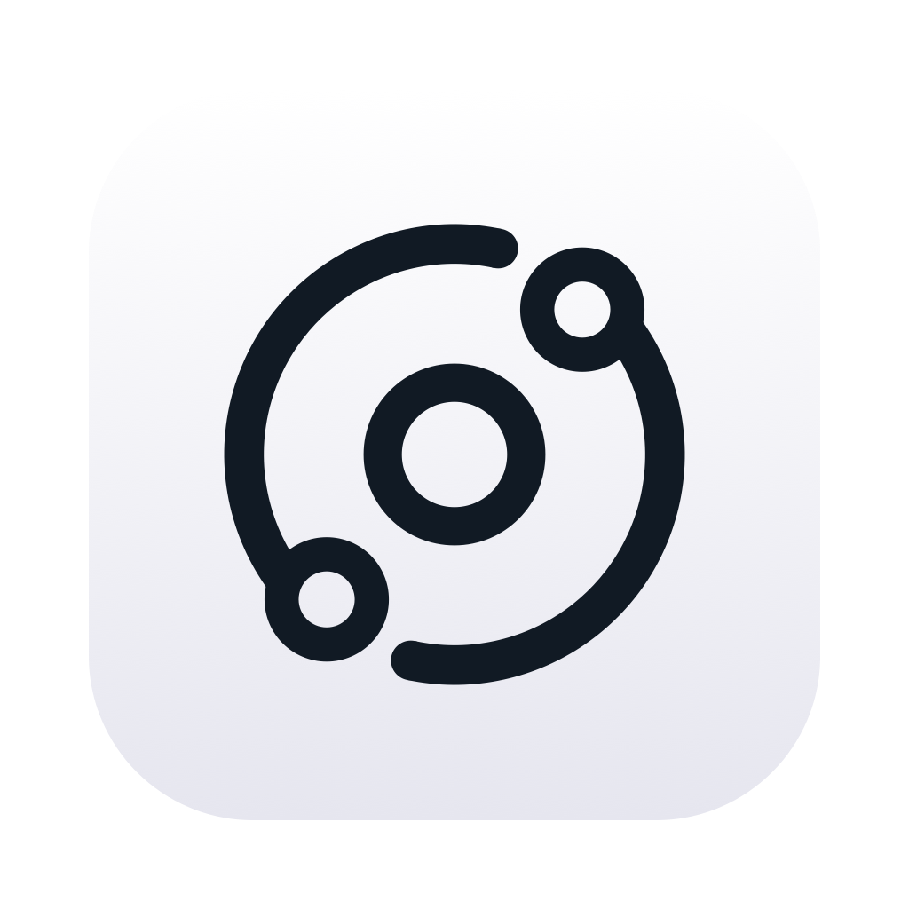

<!-- SPDX-FileCopyrightText: (C) 2026 Lucas Magotteaux -->
<!-- SPDX-License-Identifier: MIT -->
<!-- Orbit file added: 2026-11-01 by Lucas Magotteaux; see NOTICE.md. -->

<p align="center"></p>

# Orbit

Orbit shares one keyboard, mouse and **trackpad** between Macs, and lets you
**drag files and folders** from one Mac to another, like Universal Control.

Orbit is macOS only. It is based on [Deskflow](https://github.com/deskflow/deskflow)
(GPL-2.0) and is not affiliated with or endorsed by the Deskflow project.
Please report Orbit problems here, not to Deskflow. For the inherited
Deskflow documentation, see [docs/Readme.md](docs/Readme.md).

## What it does

- Drag files **and folders** from the server to a client, and from a client
  back to the server.
- Drop anywhere that accepts files. Items appear right away, **greyed out with
  a progress pie** like a Finder copy, and turn into the real items as their
  data arrives.
- A **Finder-style copy window** ("Copie de 12 éléments dans « Bureau »",
  bar, size and time left, stop button), one row per transfer.
- **Several transfers at once**: start a new drag while the previous one is
  still arriving.
- Cancel from Finder's ⓧ or the copy window, or by dropping on nothing.
- Files travel over the existing **TLS** connection; no extra port,
  nothing leaves your network. Mouse and keyboard stay responsive during big
  transfers (at most ~512 KB of file data in flight).

## Trackpad gestures

While the cursor is on a client, trackpad gestures made on the server act on
the client: three- and four-finger swipes (Spaces, Mission Control, App
Exposé), pinch and rotate. Two-finger scrolling arrives as trackpad scrolling,
with smooth deltas, momentum and rubber-banding, so a two-finger swipe left or
right goes back and forward in browsers ("Swipe between pages" in the client's
Trackpad or Mouse settings decides, as usual). Clients running Deskflow get ordinary wheel scrolling.

The **Accessibility Zoom** gesture works too: a three-finger double-tap turns
Zoom on or off, and a three-finger double-tap that stays down and drags up or
down zooms in or out, with the magnifying glass pointer (+ or −) while you
drag, as on a Mac with a trackpad. On the client, turn on both "Use trackpad gesture to
zoom" and "Use scroll gesture with modifier keys to zoom" (System Settings →
Accessibility → Zoom). The client may have no trackpad, so the server
recognizes the gesture and the client applies it as scroll-gesture zoom. The
modifier key you choose does not matter to Orbit.

## Requirements and limits

- **macOS on both computers** (tested on macOS 27, Apple Silicon). Windows and
  Linux are not implemented.
- **Both computers must run Orbit.** A Deskflow peer still works for mouse,
  keyboard and clipboard; it just doesn't get drag and drop or gestures.
- No resume of interrupted transfers, no compression.
- Clipboard sharing handles locally copied text, HTML and images. Finder file
  copies and clipboard items arriving through macOS Universal Clipboard are
  skipped before reading their contents. All clipboard service calls run on a
  separate worker: if macOS stalls during a Handoff download, clipboard sharing
  waits while mouse and keyboard handling continues. Clipboard updates can take
  about a second to appear. Use drag and drop to transfer files. This does not
  disable Handoff or Universal Clipboard for other apps; macOS has no supported
  file-only switch for that feature.
- macOS asks for **Accessibility** permission and,
  the first time you drag from Desktop, Documents or Downloads, for access to
  that folder.

## Install

Build from source (below). Unsigned builds have to be opened with
right-click → Open the first time.

```sh
brew install cmake ninja qt openssl@3
cmake -S. -Bbuild -G Ninja -DCMAKE_BUILD_TYPE=RelWithDebInfo -DBUILD_INSTALLER=OFF \
  "-DCMAKE_PREFIX_PATH=$(brew --prefix qt);$(brew --prefix openssl@3)" \
  -DOPENSSL_ROOT_DIR="$(brew --prefix openssl@3)"
cmake --build build
```

For a tagged release, prepare the matching dependency source cache as described
in [source distribution](docs/source-distribution.md), then package a
self-contained app you can copy to another Mac:

```sh
tools/filedrag/package-macos.sh build dist "Apple Development: you@example.com (TEAMID)" build/compliance-sources
```

Install the resulting `Orbit.app` on both computers.

Orbit automatically checks [GitHub Releases](https://github.com/mmmago/orbit/releases)
and downloads newer stable builds. It asks before installing and restarting.
Open **About Orbit** to check manually or turn off automatic downloads.
Release packaging and signing instructions are in [docs/releases.md](docs/releases.md).

Each app release also provides `Orbit-sources-macos-arm64.tar.gz` on the same
release page: Orbit's matching source, bundled libraries' source, patches and
build scripts. See [source distribution](docs/source-distribution.md) and
[third-party notices](THIRD_PARTY_NOTICES.md). The app includes these legal
documents under `Orbit.app/Contents/Resources/Legal/`.

## Settings

Trackpad gestures are **on** by default. Turn them off with **Enable
trackpad gestures for macOS** in the server configuration (or
`trackpadGestures=false` in the `[server]` section of the settings file).

File drag and drop is **on** by default. To turn it off, set
`enableFileDragDrop=false` in the `[server]` section of the Orbit settings
file on the server (`~/Library/Orbit/Orbit.conf`).

## How it works

A short version is in the design notes:
[docs/drag-and-drop-design.md](docs/drag-and-drop-design.md) — protocol
messages, flow control, the drag helper, and why each piece is the way it is.
Developer and test tools are in [tools/filedrag](tools/filedrag).

## License

Orbit is free software under the **GNU General Public License, version 2 only**,
with the OpenSSL exception, the same terms as Deskflow (see [LICENSE](LICENSE)
and [LICENSES](LICENSES)). If you share Orbit builds, share this source code
with them. What Orbit changes compared with Deskflow is listed in
[NOTICE.md](NOTICE.md).
