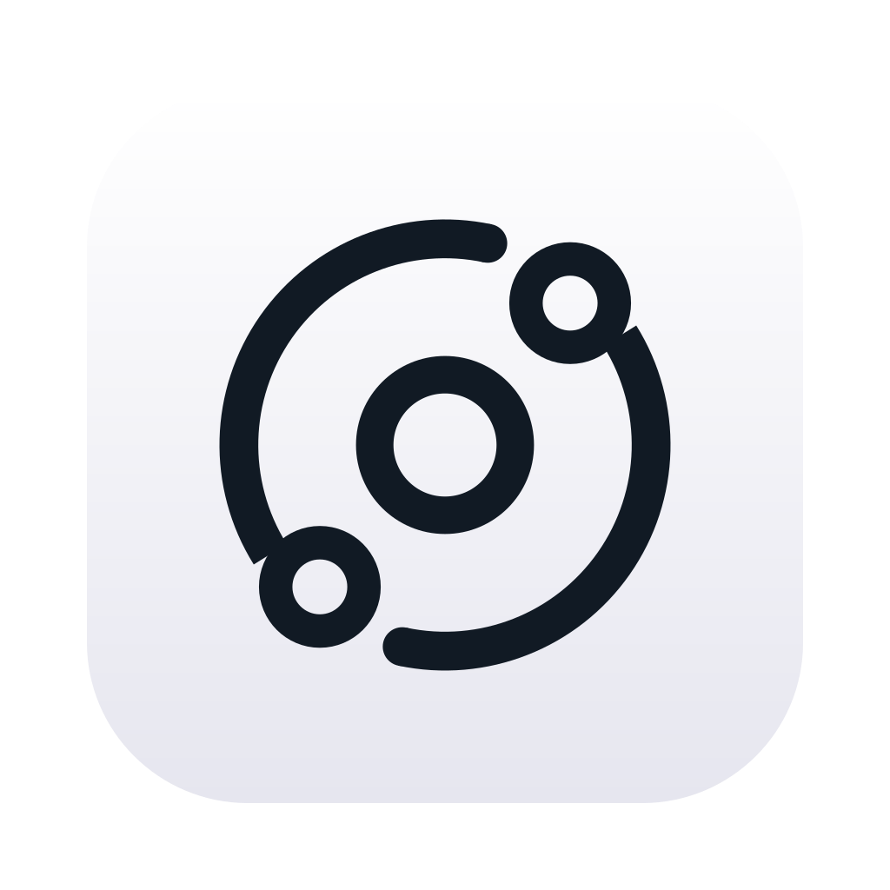

<!-- SPDX-FileCopyrightText: (C) 2026 Lucas Magotteaux -->
<!-- SPDX-License-Identifier: MIT -->
<!-- Orbit file added: 2026-11-01 by Lucas Magotteaux; see NOTICE.md. -->

<p align="center"></p>

# Orbit

One keyboard, mouse and trackpad for several Macs, with drag and drop of
files between them, like Universal Control.

Orbit is macOS only and based on [Deskflow](https://github.com/deskflow/deskflow)
(GPL-2.0). It is not affiliated with the Deskflow project: report Orbit
problems here.

## Features

- **Drag and drop**: drag files and folders from one Mac to the other and
  drop them anywhere. They show up at once with a Finder-style progress, and
  several transfers can run together.
- **Trackpad gestures**: swipes (Spaces, Mission Control), pinch, rotate,
  smooth scrolling and swiping between pages work on the other Mac, as does
  the Accessibility Zoom gesture.
- **Clipboard**: copy text, HTML or images on one Mac, paste on the other.
- **Touch ID unlock**: unlock a locked client with Touch ID on the server
  (see below).
- Everything goes over one TLS connection on your network.

## Touch ID unlock

1. On the client, open the Orbit panel and turn on **Unlock with the
   server's Touch ID**, then enter that Mac's password once. Orbit checks it
   and keeps it in that Mac's Keychain; it never leaves that Mac.
2. When the client is locked, move the cursor onto it (or click on it) and
   touch Touch ID on the server. The client types its password into its lock
   screen.

Touch ID shows in a small panel at the top of the server's screen, or in
place of Orbit's menu bar icon with **Touch ID permission in menu bar** in the
server options. It needs TLS, Orbit 1.2 on both Macs and Touch ID on the
server (built in or on a Magic Keyboard). It works after the screen locks,
not after a restart or logout.

## Install

Download `Orbit-macos-arm64.zip` from
[Releases](https://github.com/mmmago/orbit/releases) and put `Orbit.app` in
Applications on every Mac. Pick one Mac as the server, the others as clients.
macOS asks for **Accessibility** permission; if it blocks the first launch,
allow it in System Settings → Privacy & Security.

Orbit checks for new releases and asks before installing them (**About
Orbit**).

## Settings

The options are in the Orbit panel (menu bar icon): trackpad gestures, drag
and drop and clipboard on the server, scroll direction and Touch ID unlock on
the client. They are saved in `~/Library/Orbit/Orbit.conf`.

## Build from source

```sh
brew install cmake ninja qt openssl@3
cmake -S. -Bbuild -G Ninja -DCMAKE_BUILD_TYPE=RelWithDebInfo -DBUILD_INSTALLER=OFF \
  "-DCMAKE_PREFIX_PATH=$(brew --prefix qt);$(brew --prefix openssl@3)" \
  -DOPENSSL_ROOT_DIR="$(brew --prefix openssl@3)"
cmake --build build
```

Packaging and releases: [docs/releases.md](docs/releases.md). Drag and drop
design: [docs/drag-and-drop-design.md](docs/drag-and-drop-design.md).

## License

GNU General Public License, version 2 only, with the OpenSSL exception, as
Deskflow ([LICENSE](LICENSE), [LICENSES](LICENSES)). Each release includes
`Orbit-sources-macos-arm64.tar.gz` with the matching source of Orbit and its
bundled libraries ([source distribution](docs/source-distribution.md),
[third-party notices](THIRD_PARTY_NOTICES.md)). Changes from Deskflow are
listed in [NOTICE.md](NOTICE.md).
